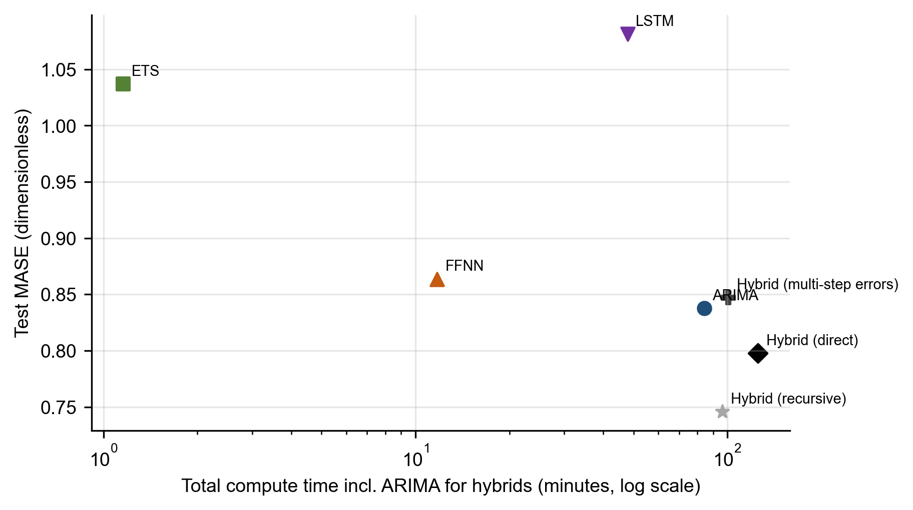
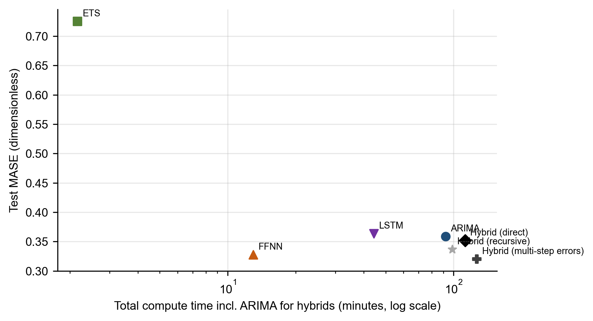
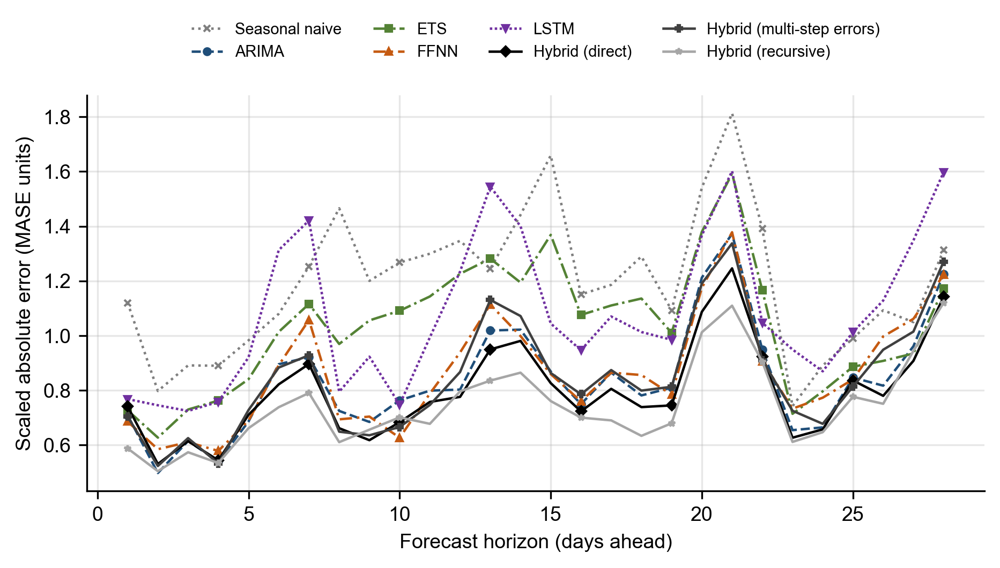
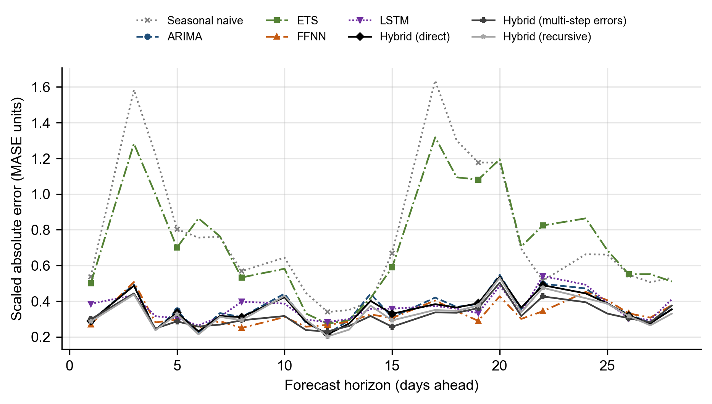
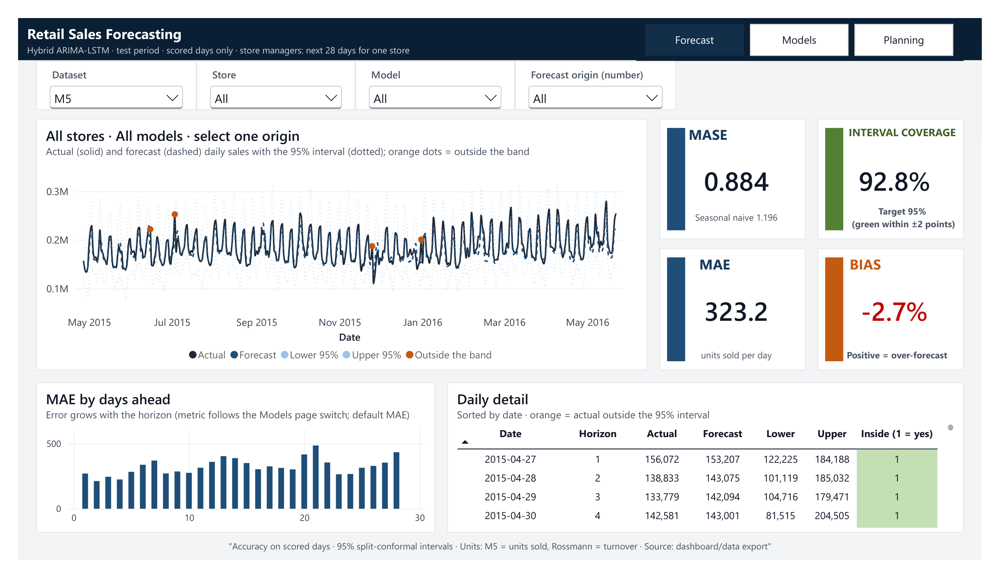
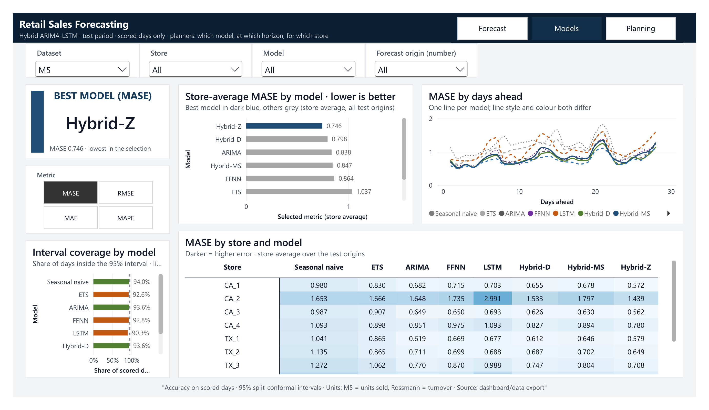
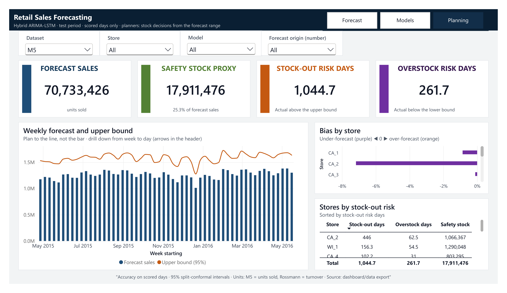
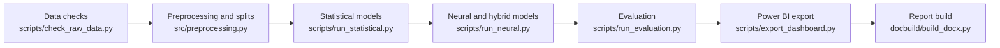

# Hybrid ARIMA-LSTM Retail Sales Forecasting with BI Integration

28-day store-level sales forecasts with calibrated prediction intervals, delivered to a Power BI planning dashboard.

[](https://github.com/Farid89-data/Hybrid-ARIMA-LSTM-retail-sales-forecasting-with-BI-integration/actions/workflows/ci.yml)    [](https://www.kaggle.com/datasets/frd894563524452/retail-sales-forecasts-hybrid-arima-lstm-results) 

## Results at a glance

Test period, 28-day horizon, rolling origins. MASE is the mean absolute scaled error (below 1 beats the in-sample seasonal naive error); lower is better. Networks use five seeds.

**M5 (Walmart, 10 stores; mean absolute error in units sold per day)**

| Role | Model | MASE | MAE | Interval coverage (95%) |
|---|---|---:|---:|---:|
| Best model | Hybrid, recursive (hyb_z) | 0.746 | 276.5 | 94.3% |
| Best benchmark | ARIMA | 0.838 | 311.0 | 93.6% |
| Benchmark | Seasonal naive | 1.196 | 467.5 | 94.0% |

**Rossmann (20 sampled stores; mean absolute error in turnover per day)**

| Role | Model | MASE | MAE | Interval coverage (95%) |
|---|---|---:|---:|---:|
| Best model | Hybrid, multi-step errors (hyb_ms) | 0.320 | 674.5 | 94.0% |
| Benchmark | ARIMA | 0.359 | 758.8 | 95.7% |
| Best benchmark | Feed-forward network (FFNN) | 0.328 | 689.2 | 96.1% |
| Benchmark | Seasonal naive | 0.767 | 1,647.8 | 93.9% |

- **Where the hybrid wins.** On M5, the recursive hybrid has a MASE of 0.746 against 0.838 for ARIMA (-11.0%), and it is significantly better than each of the seven other models in all five seeds under both losses (Diebold-Mariano tests, Holm-adjusted over the primary family of seven comparisons). M5 has only ten series.
- **Where it is not significantly better.** On Rossmann, the multi-step hybrid has the lowest MASE (0.320 against 0.359 for ARIMA, -10.8%), but the gain over ARIMA is significant in only 3 of 5 seeds, so it is not robust, and it is not robustly better than the FFNN, the direct hybrid, the recursive hybrid and the LSTM. On M5, the multi-step hybrid is +1.1% against ARIMA.
- **Interval coverage.** The 95% conformal intervals covered 90.3% to 96.3% of test days. Coverage was below 95% for 8 of 8 models on M5 and 5 of 8 on Rossmann.

## Figures

<table><tr><td></td><td></td></tr><tr><td align="center">Accuracy against cost, M5</td><td align="center">Accuracy against cost, Rossmann</td></tr><tr><td></td><td></td></tr><tr><td align="center">Error by forecast horizon, M5</td><td align="center">Error by forecast horizon, Rossmann</td></tr></table>

## Dashboard

<table><tr><td></td><td></td><td></td></tr><tr><td align="center">Forecast</td><td align="center">Models</td><td align="center">Planning</td></tr></table>

The dashboard was designed for accessibility: a palette of blue, green, orange and purple, line styles and markers as well as colour, dark text, alt text on every visual and a logical tab order. Measures that sum sales return blank unless one dataset is selected, so that units and turnover are never mixed. The functional tests passed, as did the colour-vision and greyscale checks. The Power BI file itself is not in the repository, because it stores the competition data; the theme, the measure checklist and the page images are in `dashboard/`, and a PDF export of the three pages is in `reports/PowerBI/Dashboard.pdf`.

## Architecture



| Module | Role |
|---|---|
| `src/config.py` | Central configuration: paths, experimental constants and dataset settings |
| `src/data_loader.py` | Loading the raw Kaggle files into a common daily panel structure |
| `src/evaluation.py` | Forecast accuracy and interval metrics |
| `src/experiment.py` | Experiment orchestration shared by the command-line scripts |
| `src/export_powerbi.py` | Export a star schema of actuals, forecasts and metrics for the Power BI dashboard |
| `src/feature_engineering.py` | Supervised windows for the neural models |
| `src/hybrid_model.py` | Hybrid ARIMA-LSTM: residual preparation, network inputs and forecast combination |
| `src/neural_networks.py` | Feed-forward and LSTM forecasters (Keras 3 / TensorFlow) |
| `src/preprocessing.py` | Chronological splitting, missing-value handling and scaling |
| `src/statistical_models.py` | Statistical benchmarks: seasonal naive, (S)ARIMA(X) and ETS |
| `src/statistical_tests.py` | Diebold-Mariano test of equal predictive accuracy with the Harvey-Leybourne-Newbold correction |
| `src/tuning_cleanup.py` | Clean-up of interrupted Optuna trials (D-029) |
| `src/utils.py` | Shared utilities: logging, determinism, timing, energy estimates and the experiment log |
| `src/visualisation.py` | Figure style shared by every report figure: 300 dpi, greyscale-legible, labelled axes |
| `scripts/run_statistical.py` | Fit the statistical benchmarks (seasonal naive, ARIMA, ETS) for one dataset |
| `scripts/run_neural.py` | Tune (Optuna) and train one neural model kind for one dataset |
| `scripts/run_evaluation.py` | Evaluate every model on the test origins and produce the report tables and figures |
| `scripts/run_chunks.py` | Pausable pipeline runner (D-028): lanes with dependencies, memory admission and safe pauses |
| `scripts/export_dashboard.py` | Export the Power BI star schema (run after scripts/run_evaluation.py) |
| `scripts/make_report_tables.py` | Format result files into the report-ready tables used by the Word build |

## Engineering highlights

- Leakage-safe rolling-origin evaluation: scalers, ARIMA and ETS parameters and network weights use only data before each cut-off; `tests/test_leakage.py` perturbs future data and checks that training inputs do not change.
- 71 automated tests (pytest) and a continuous-integration workflow (`.github/workflows/ci.yml`).
- Checkpointed, resumable and pausable pipeline runner with a memory guard and parallel lanes (`scripts/run_chunks.py`, `Resume-Pipeline.bat`, `Pause-Pipeline.bat`, `Status-Pipeline.bat`).
- Five seeds for every network, fixed seeds and deterministic TensorFlow operations (`DECISIONS_LOG.md`, D-018).
- An experiment log with one row per tuning trial and final run (`EXPERIMENT_LOG.csv`) and a decisions log with alternatives and reasons (`DECISIONS_LOG.md`).
- Automated report build with checks that fail the build: caption layout (`docbuild/check_captions.py`), test count (`docbuild/check_test_count.py`) and citations (`docbuild/citation_audit.py`).
- Total compute for the final experiments: 7.1 hours on one two-core laptop without a graphics processor.

## Quick start

Python 3.13 is required.

```
python -m venv .venv
.venv\Scripts\activate        (Windows)   or   source .venv/bin/activate
pip install -r requirements.txt
```

1. Download the competition files into the folder described in `data/README.md` and verify them: [M5 Forecasting - Accuracy](https://www.kaggle.com/competitions/m5-forecasting-accuracy/data), [Rossmann Store Sales](https://www.kaggle.com/competitions/rossmann-store-sales/data).
   ```
   python scripts/check_raw_data.py --verify
   ```
2. Run the pipeline (Windows): `Resume-Pipeline.bat` starts it or resumes it from the checkpoints, `Pause-Pipeline.bat` pauses it safely and `Status-Pipeline.bat` shows the progress. Each stage can also be run on its own (see `scripts/` and `data/README.md`).
3. Run the tests:
   ```
   python -m pytest -q
   ```
4. Rebuild the dashboard export (writes `dashboard/data/`):
   ```
   python scripts/export_dashboard.py
   ```
5. Regenerate this page from the result files: `python scripts/make_readme.py`.

## Repository layout

| Path | Content |
|---|---|
| `src/` | Python package: data loading, preprocessing, models, evaluation, statistical tests, Power BI export |
| `scripts/` | Command-line entry points for each stage, the pipeline runner and the checks |
| `tests/` | pytest suite, including the leakage tests |
| `notebooks/` | Walkthrough notebooks that read the pipeline outputs |
| `dashboard/` | Power BI data model documents, DAX measures, theme, measure checklist and page images |
| `docbuild/` | Build scripts and checks for the dissertation Word file (the dissertation text itself is not in the repository) |
| `data/` | Instructions for obtaining the Kaggle files and their reference checksums (no raw data) |
| `outputs/` | Metrics, tables, figures and logs written by the pipeline (forecasts are not tracked) |
| `reports/` | Verification and clean-up reports |
| `DECISIONS_LOG.md` | Design decisions with alternatives and reasons |
| `EXPERIMENT_LOG.csv` | One row per tuning trial and final run |

## Reproducibility and data policy

The original M5 and Rossmann data are not redistributed, in line with the competition rules, and neither are the actual daily sales or files derived from them (the forecast files and the dashboard fact tables are not tracked). The author's own derived results (forecasts without the actual sales, accuracy measures, tests, model settings and costs) are published as a [Kaggle dataset](https://www.kaggle.com/datasets/frd894563524452/retail-sales-forecasts-hybrid-arima-lstm-results); each file there maps to the tables written by this pipeline (`outputs/tables/`, `outputs/metrics/`), and the dataset page explains how to rejoin the forecasts with the original data.

## Limitations

- M5 has only 10 series here (ten stores), so conclusions about the hybrid on M5 may not carry over to other retailers; Rossmann uses a sample of 20 stores.
- Both datasets have one test period each; the five seeds measure variation from network initialisation, not from the choice of test period.
- The 95% intervals are split conformal and calibrated on the validation windows before the test period; the exchangeability they assume holds only approximately, and coverage varies with the horizon.
- Runtimes were measured on one laptop, partly with parallel jobs sharing the processor, so they are indicative and not strictly comparable across stages.

## Citation

```bibtex
@software{negahbani2026,
  author = {Negahbani, Farid},
  title = {Hybrid ARIMA-LSTM Retail Sales Forecasting with BI Integration},
  year = {2026},
  url = {https://github.com/Farid89-data/Hybrid-ARIMA-LSTM-retail-sales-forecasting-with-BI-integration}
}
```

Citation metadata: [`CITATION.cff`](CITATION.cff). Licence: MIT ([`LICENSE`](LICENSE)).

The dissertation text is available on request or after publication.

## Contact and profiles

Author: Farid Negahbani.

- Kaggle dataset: <https://www.kaggle.com/datasets/frd894563524452/retail-sales-forecasts-hybrid-arima-lstm-results>
- LinkedIn: <https://www.linkedin.com/in/farid-negahbani/>
- GitHub: <https://github.com/Farid89-data>
- Portfolio: <https://www.datascienceportfol.io/frdngbsn>
- XING: <https://www.xing.com/profile/Farid_Negahbani>
